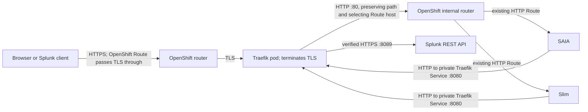

# Validated Traefik pattern for Splunk AI POD

This guide records the Traefik traffic pattern exercised in the Splunk AI POD
OpenShift test on 2026-11-12. It covers browser/client ingress to SAIA and
Slim, plus the two tested Splunk token-validation callbacks. It does not claim
formal FIPS certification for the Traefik image or the full solution.

The test ran Traefik inside the OpenShift cluster in `ai-platform`. TLS
terminated at Traefik. Existing SAIA and Slim Routes and services remained
HTTP. The examples below describe the tested routing behavior; replace test
hostnames, certificate material, callback CA/SAN, and browser origin with the
values observed in the target deployment, then repeat the listed checks.

## Validated traffic flow

The outer OpenShift Routes in the test used TLS passthrough to the Traefik
public Service. Traefik held the test certificate and performed TLS
termination. Its public routers forwarded HTTP to the OpenShift internal
router on port 80, while providing the existing application Route host. This
preserved selection of the SAIA or Slim backend without changing those
workload Routes.

## Tested deployment profile

The test used a single Traefik 3.6.14 pod in `ai-platform` with separate
entrypoints for public HTTPS (`:8443` in the pod) and private callback HTTP
(`:8080`). The public Service exposed port 443 to the passthrough Routes; the
callback ClusterIP Service exposed only port 8080 and had no public Route.
Traefik's Kubernetes CRD provider watched only `ai-platform`, disabled
cluster-scoped resources, and did not enable the Kubernetes Ingress provider.
The pod ran non-root with a read-only root filesystem, no added capabilities,
and RuntimeDefault seccomp.

The test image was Traefik `v3.6.14-1783379655-0246af9e4924` on linux/amd64.
The test set `GODEBUG=fips140=only`. This runtime setting alone does not
establish FIPS qualification. Go documents `fips140=only` as a best-effort
testing, assessment, and debugging mode and says it is not intended for
production. Confirm the approved image build, linked module version, and
operating environment with the product/security owner before making a FIPS
claim. See [Go FIPS 140-3 guidance](https://go.dev/doc/security/fips140) and
[NIST certificate 5247](https://csrc.nist.gov/projects/cryptographic-module-validation-program/certificate/5247).

## Configure the tested ingress behavior

1. Keep the existing SAIA and Slim application Routes HTTP, as they were in
   the validated test. Do not add TLS between Traefik, the OpenShift router,
   and these application Services as part of this tested pattern.
2. Create one OpenShift TLS-passthrough Route for each public Traefik hostname,
   targeting the Traefik public Service on port 443. The test Routes were
   admitted and forwarded the TLS connection to Traefik.
3. Configure the Traefik public entrypoint with the certificate for the
   requested public hostname. Match the public hostname in an `IngressRoute`
   and forward to the in-cluster OpenShift router's HTTP Service on port 80.
4. On each router, set the `Host` header to the corresponding existing SAIA
   or Slim Route hostname. Preserve the request path, query, authorization
   headers, and response. The test used this host selection to route both
   applications through the internal OpenShift router.
5. For SAIA, the browser preflights returned HTTP 204 and conversation history
   requests returned HTTP 200 without a Traefik CORS middleware.
6. For Slim, the application returned HTTP 400 to the browser preflight with
   `Request ID not present in header`. A test-only Traefik CORS middleware
   returned the required allow-origin, allow-headers, allow-methods, and
   allow-credentials headers. The middleware was tested with origin
   `http://127.0.0.1:8000` and these request headers: `Authorization`,
   `Content-Type`, `request_id`, `x-request-id`, `X-Requested-With`,
   `Splunk-Client`, and `X-Stack-URL`. The middleware must use the exact
   Splunk Web origin and headers observed in the customer browser; the local
   origin above is test data, not a customer value.

## Configure and check the tested callback paths

SAIA and Slim made HTTP requests to a private ClusterIP Traefik listener on
port 8080. The listener had no OpenShift Route. The tested router matched only
these GET paths:

| Path | Expected response without a bearer token |
|---|---|
| `/services/authorization/tokens-keys` | HTTP 200 |
| `/services/authentication/current-context` | HTTP 401 |

The tested Traefik upstream used HTTPS and a `ServersTransport` with the
Splunk test CA and `serverName` matching the Splunk certificate SAN. Traefik
verified the certificate chain and hostname. The actual SAIA and Slim pods
received the expected responses through the private callback router. An
authenticated current-context call through the earlier application relay
returned HTTP 200.

For this laptop test, a short-lived transparent TCP tunnel carried the
encrypted connection between Traefik and the loopback-only Splunk listener.
It did not terminate or modify TLS. This proves Traefik's HTTPS client,
certificate verification, router selection, and callback handling. Direct
cluster-to-customer-Splunk network reachability was not tested in this lab.
Do not use the temporary tunnel as a customer deployment component.

The test allowlist intentionally did not proxy all of `/services/*`. The two
paths above are the only callback paths established by this validation. Add
other paths only after observing and separately validating the relevant SAIA
or Slim flow.

## Validation performed

Run equivalent checks with the target deployment's hostnames and CA:

- HTTPS `/health` through both public Traefik hostnames returned HTTP 200 with
  certificate verification enabled.
- Traefik access logs showed forwarding to the internal OpenShift router and
  the intended SAIA or Slim Route.
- SAIA metadata and v2 query returned HTTP 200; the browser loaded the saved
  conversation history.
- Slim model-list and non-streaming v2 inference returned HTTP 200. The
  browser CORS test reached Slim and JavaScript could read the response; the
  deliberately invalid bearer produced HTTP 401, which is expected for that
  specific CORS check.
- From both SAIA and Slim, the two callback paths returned the expected
  unauthenticated statuses shown above. Traefik logs showed an HTTPS upstream
  and successful certificate/SAN verification.

The more detailed dates, response evidence, and test limitations are in the
[validation record](./fips-traefik-validation-plan.md).
