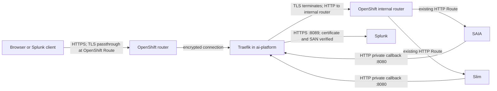

# Splunk AI POD Traefik validation record

**Updated:** 2026-11-12
**Result:** The in-cluster Traefik request paths required for SAIA and Slim were exercised. Traefik terminated public TLS, forwarded requests to the existing HTTP Routes, and made a certificate-verified HTTPS connection to Splunk for the tested token-validation callbacks. This is functional network evidence, not FIPS certification evidence.

This record is limited to the Splunk AI POD OpenShift test. It does not use a cloud-hosted Splunk deployment. The customer-facing reference is [FIPS-mode Traefik for Splunk AI POD](./fips-traefik-customer-setup.md). Only the public ingress, browser CORS, and callback paths described below were tested.

## Tested architecture

The public OpenShift Routes used for the test were TLS passthrough Routes to
Traefik. The existing SAIA and Slim Routes remained HTTP. Traefik forwarded
public requests to the in-cluster OpenShift router on port 80, with the
existing application Route host supplied so the router selected the right
backend. The private callback listener was a ClusterIP Service on port 8080
and had no OpenShift Route.

## Completed validation

| Area | Test and observed result |
|---|---|
| Traefik runtime | One Traefik 3.6.14 replica ran Ready in `ai-platform`, on linux/amd64. It used `GODEBUG=fips140=only`, non-root execution, a read-only root filesystem, dropped capabilities, and the RuntimeDefault seccomp profile. |
| Public TLS | HTTPS health requests to both temporary public hosts returned HTTP 200 with certificate verification enabled. Chrome loaded the test hosts without a certificate warning after the test CA was trusted. |
| Public routing | Traefik forwarded requests over HTTP to the internal OpenShift router while preserving the application path and query and selecting the existing SAIA or Slim Route host. SAIA and Slim health checks returned HTTP 200. |
| SAIA | Metadata and v2 query requests returned HTTP 200. The SAIA browser history flow loaded: the browser preflights returned 204 and conversation list, detail, and item requests returned 200. The saved conversation rendered. |
| Slim | `/tenant/slim-api/v1alpha1/chat/models` and a non-streaming v2 completion returned HTTP 200. The completion response matched the test phrase. |
| Slim browser CORS | The Slim application returned HTTP 400 to the initial preflight. A test-only Traefik CORS middleware allowed the exact local origin `http://127.0.0.1:8000` and observed request headers. Chrome `fetch` then read the deliberately unauthenticated HTTP 401 response, demonstrating that the browser accepted the preflight and response CORS headers. |
| Callback route selection | From both SAIA and Slim, GET `/services/authorization/tokens-keys` returned HTTP 200 and unauthenticated GET `/services/authentication/current-context` returned HTTP 401 through the private Traefik callback router. An earlier authenticated test through the application relay returned HTTP 200 for current-context. |
| Callback TLS | The actual callback IngressRoute was temporarily pointed to a transparent TCP tunnel that forwarded encrypted bytes to laptop Splunk. Traefik used an HTTPS upstream with the test CA and `serverName: splunk-laptop-relay.test`; certificate chain and SAN verification succeeded. Traefik logs showed the callback router and HTTPS upstream for requests from both workloads. TLS terminated at Splunk. |

The direct HTTPS callback test used a transparent tunnel only to carry TCP
between the cluster and a laptop Splunk listener bound to loopback. The tunnel
did not terminate TLS or modify HTTP. Its Kubernetes resources were removed
after the test, and the callback route was restored to the existing test relay.
No TLS verification was disabled.

## Separate analysis and limitations

- **Direct network route to laptop Splunk:** A direct connection from the
  workloads to the laptop interfaces timed out because Docker published
  Splunk's management port on loopback. The tunnel allowed Traefik's own TLS
  validation and callback routing to be tested; it does not prove a direct
  cluster-to-laptop network route. This is a limitation of this laptop test
  topology, not evidence about customer networks.
- **Customer network topology:** The test used an in-cluster Traefik
  Deployment and the OpenShift internal router. A customer's DNS, firewall,
  network policies, router exposure, and Splunk endpoint are not established
  by this lab result.
- **Callback scope:** Only the two token-validation GET paths listed above
  were allowed and exercised. This test does not validate every Splunk REST
  path that a SAIA feature might use. Do not treat the two-path router as a
  general `/services/*` proxy.
- **CORS scope:** The Slim CORS result is specific to the local test origin and
  the observed headers. A different Splunk Web origin or header set needs its
  own preflight check.
- **FIPS qualification:** The test process had `GODEBUG=fips140=only`. Go
  documents this as a best-effort setting for testing, assessment, and
  debugging, not a production setting. The exact linked Go Cryptographic
  Module, build provenance, approved operating environment, and application
  validation are not established. Do not describe this test as certified or
  qualified FIPS operation. See the [Go FIPS 140-3 guidance](https://go.dev/doc/security/fips140)
  and [NIST certificate 5247](https://csrc.nist.gov/projects/cryptographic-module-validation-program/certificate/5247).
- **Out of scope:** AITK UI, Slim streaming, broad negative or resilience tests,
  and SAIA search-tool route discovery were not part of the requested POD
  ingress/callback validation.

## Test environment state

The test Traefik Deployment, public passthrough Routes, and test CORS middleware
remain in the test namespace. The temporary raw TCP tunnel and its TLS
transport/Secret are removed. The private callback route currently points to
`ai-pod-laptop-callback-relay` on HTTP port 19444; the test-only Slim CORS
middleware remains attached to the Slim test route. These are test resources,
not customer configuration. They were left in place so the laptop test path
was not broken by cleanup. No production workloads were changed.
